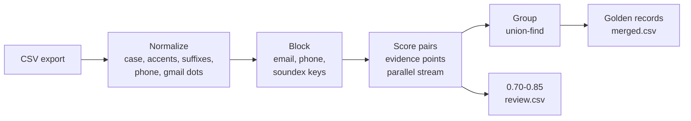

# crm-dedupe

[](https://github.com/smileyDDx1/crm-dedupe/actions/workflows/ci.yml)

A command-line tool that finds duplicate contacts in a CRM export (CSV) with fuzzy matching, and writes back a cleaned list with one row per real person.

Plain **Java 21**, no framework: records, streams, parallel streams and a few classic algorithms (Soundex, Jaro-Winkler, union-find). It finds 12,598 duplicate rows in a 53,847-row file in 4.5 seconds on my laptop, and it can measure its own precision and recall on generated test data.

I built it because CRM data is full of duplicates that exact matching misses: the same person typed by a sales rep, imported from a webinar list and synced from an email tool, each time a little differently.

## Example

These three rows from [samples/contacts.csv](samples/contacts.csv) are one person:

| id | first | last | email | phone | company | city | updated |
|---|---|---|---|---|---|---|---|
| C000003 | Michael | **Shamra** | michael.sharma@riverstonecapital.com | | Riverstone Capital Pvt Ltd | | 2025-11-18 |
| C000081 | Michael | Sharma | michael.sharma@riverstonecapital.com | 8915081135 | Riverstone Capital Pvt. Ltd. | Jaipur | 2026-03-16 |
| C000145 | **Micharl** | Sharma | | 8915081135 | Riverstone Capital Inc. | Jaipur | 2025-03-15 |

C000003 and C000145 have different typos and share neither an email nor a phone number, so they don't match each other directly. Each of them matches C000081, and union-find joins all three. The merged row keeps C000081 (the most recent one) and fills its fields from all three.

## Results

All numbers are from the real jar on generated data (`generate --people 40000 --seed 42`: 53,847 rows, 13,847 of them duplicates). Laptop: Intel i3-1115G4 (2 cores / 4 threads), inside Docker.

**Accuracy** (pairs of rows; [how it's measured](docs/questions-answers.md#how-do-you-measure-precision-and-recall-without-labelled-real-data)):

| Threshold | Precision | Recall | F1 |
|---|---|---|---|
| 0.70 (start of the "maybe" band) | 92.11% | 96.27% | 94.14% |
| 0.80 | 99.92% | 91.71% | 95.64% |
| **0.85 (default)** | **100.00%** | **89.68%** | 94.56% |
| 0.95 | 100.00% | 87.24% | 93.18% |

At the default threshold nothing was merged wrongly, and 89.7% of the duplicate pairs were merged automatically. Most of the rest score between 0.70 and 0.85 and go to `review.csv` for a human. My first scoring model got **16.7% precision** on the same data; [why, and what fixed it](docs/questions-answers.md#why-evidence-points-instead-of-a-weighted-average).

**Blocking** (only comparing rows that share a key):

| | Every pair | With blocking |
|---|---|---|
| 53,847 rows: pairs compared | 1,449,722,781 | 4,964,898 (99.66% fewer) |
| 10,707 rows: pairs compared | 57,314,571 | 200,767 (99.65% fewer) |
| 10,707 rows: scoring time | 45.9 s | 0.3 s |
| 10,707 rows: precision / recall at 0.85 | 100.00% / 89.65% | 100.00% / 89.65% |

Blocking let through 99.25% of the real duplicate pairs. The ones it missed can't matter at the default threshold: without the same email or phone a pair scores at most 0.80 (name 0.60 + company 0.15 + city 0.05), and email and phone are both blocking keys. So at 0.85 blocking only loses a match if a block was skipped for being too big. On the 10,707-row file, the result at 0.85 is identical to comparing every pair.

**Speed** (53,847 rows): the whole `find` command takes **4.5 s**. Scoring the 5 million pairs takes 3.0 s on 4 threads vs 5.5 s on one (`--sequential`).

> **Caveat:** I wrote both the data generator and the matcher, and in the generated data every email and phone number belongs to exactly one person. Real CRMs have shared inboxes and office numbers, so expect lower precision on real data. Run `evaluate` on your own labelled sample before trusting a threshold.

## How it works



1. **Normalize** every value. Most duplicates aren't typos, they're the same value written differently: `ACME Pvt. Ltd.` and `Acme Private Limited` both become `acme`, `+91 98765 43210` and `098765-43210` both become `9876543210`, and `r.a.h.u.l+crm@gmail.com` becomes `rahul@gmail.com`.
2. **Block**: every row gets up to four keys (normalized email, normalized phone, Soundex of the last name + first initial, and the same with first and last name swapped). Only rows that share a key are compared.
3. **Score** each candidate pair by adding up evidence: similar name (Jaro-Winkler, up to 0.60), same email or phone (+0.35), different email or phone (-0.10), same company (+0.15), clearly different company (-0.10), same city (+0.05). A name alone can never reach a threshold; names are common, emails and phone numbers aren't.
4. **Group** the pairs above the threshold with union-find.
5. **Merge** each group into a golden record: the most recently updated row wins, and empty fields are filled from the other rows.

The design decisions are explained in [docs/questions-answers.md](docs/questions-answers.md).

## Usage

Build the jar (JDK 21), or with Docker if you don't have a JDK:

```bash
./mvnw package
```

```bash
docker run --rm -v "$PWD":/app -w /app maven:3.9-eclipse-temurin-21 mvn -q package
```

Then:

```bash
# find duplicates in your own export
java -jar target/crm-dedupe.jar find -i contacts.csv -o dedupe-output

# make a messy test file where the right answer is known, and measure the matching on it
java -jar target/crm-dedupe.jar generate --people 40000 -o sample.csv
java -jar target/crm-dedupe.jar evaluate -i sample.csv
```

```text
Read 53,847 rows from sample.csv
Compared 4,964,898 pairs instead of 1,449,722,781 (99.66% fewer)
Found 12,598 duplicate rows in 9,183 groups -> 41,249 rows left
1,465 pairs need a human look (review.csv)
Wrote dedupe-output/merged.csv, dedupe-output/clusters.csv, dedupe-output/review.csv
Time: 4.5 s (normalize 0.4 s, blocking 1.0 s, scoring 2.9 s, grouping 0.1 s)
```

| Command | Options |
|---|---|
| `find` | `-i` input CSV, `-o` output folder, `--threshold` (0.85), `--review-threshold` (0.70), `--max-block-size` (1000) |
| `generate` | `-o` output CSV, `--people` (10000), `--duplicate-rate` (0.25), `--seed` (42) |
| `evaluate` | `-i` CSV with `true_entity_id`, `--exhaustive` (compare every pair), `--sequential` (one thread) |

### Output files

| File | Contents |
|---|---|
| `merged.csv` | the cleaned list: one row per real person, with `merged_ids` listing the original rows |
| `clusters.csv` | every duplicate group with all its original rows, and which row was kept |
| `review.csv` | "maybe" pairs (0.70-0.85) that were not merged, best first |

### Input format

A CSV with a header row and an `id` column. Columns are matched by common names, ignoring case and punctuation, so exports from different CRMs work without renaming: `First Name`, `Email Address`, `Mobile`, `Account Name`, `Modified Time` and so on. Recognised fields: id, first name, last name, email, phone, company, city, updated date. Other columns are ignored.

Exit codes: `0` ok, `2` bad input file or options (with a message), `1` unexpected error.

## Testing

```bash
./mvnw verify
```

**96 tests, 99.6% line coverage and 93.4% branch coverage** (JaCoCo). The algorithms are checked against published examples (Jaro-Winkler from Winkler's papers, the standard Soundex test names), the scorer against the hard cases (same name/different person, shared inbox, swapped columns, missing fields), and the CLI is run end to end in-process with temporary files. CI also runs the built jar on 20,000 generated people and uploads the evaluation.

## Project structure

```
src/main/java/com/debangshu/dedupe
├── matching/    Normalizer, Soundex, JaroWinkler, Blocker, PairScorer, UnionFind, CandidatePairs
├── pipeline/    Deduplicator (the whole run), GoldenRecordBuilder, settings and results
├── io/          CSV reader (header aliases) and writers
├── generator/   messy test data with known answers
├── evaluation/  precision, recall and blocking recall
└── cli/         picocli commands: find, generate, evaluate
```

## What I learned

- **Measure before tuning.** My first scorer looked reasonable and had 16.7% precision. The evaluate command made that obvious within seconds, and showed why: union-find chains a few wrong pairs into giant groups. Without generated data with known answers, I would have shipped it.
- **Common things are weak evidence.** Thousands of people share a name; almost nobody shares an email or a phone number. Scoring that way (evidence points, like the Fellegi-Sunter model) fixed precision.
- **Normalization does more than fuzzy matching.** Most duplicates differ in format (case, suffixes, phone formats, Gmail dots), not in spelling.
- **Blocking is a trade-off you can measure.** 99.66% fewer comparisons for a 0.75% loss in candidate pairs, and no loss at all at the default threshold.
- **Parallel streams are easy when nothing is shared.** Scoring pairs needs no locks because every pair only reads the normalized rows. On 4 threads it was 1.8 times faster (2 physical cores).
- **Small details in floating point matter at a threshold.** 0.60 - 0.10 + 0.35 must equal exactly 0.85, so scores are rounded to 6 decimals.
- **XML comments can't contain `--`.** Maven refused the POM because a comment said `--help`.

## Known limitations

- Precision and recall are measured on **generated** data (see the caveat above).
- Phone numbers are reduced to their last 10 digits, which suits Indian mobile numbers but not every country.
- No nickname handling ("Bob" / "Robert") and no frequency-aware name weights.
- Union-find is transitive, so one wrong pair can join two groups. The high default threshold keeps that rare.
- Everything is in memory: fine for a few hundred thousand rows, not for tens of millions.

More in [docs/future-plans.md](docs/future-plans.md).
